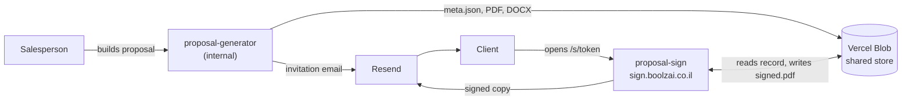

# Proposal Generator | מחולל הצעות מחיר

An internal tool for Boolzai that builds Hebrew (RTL) price proposals, exports them as PDF or Word, and sends them to clients for a digital signature.

A salesperson fills in a 5-step form, previews the proposal, and then either downloads it or clicks **Send for signature**. The client gets an email with a personal link, reads the proposal on their phone or computer, signs it on screen, and both sides receive the signed PDF by email.

---

## Contents

- [Features](#features)
- [How it works](#how-it-works)
- [Tech stack](#tech-stack)
- [Getting started](#getting-started)
- [Environment variables](#environment-variables)
- [Deployment](#deployment)
- [Project structure](#project-structure)
- [Core concepts](#core-concepts)
- [API reference](#api-reference)
- [Common changes](#common-changes)
- [Testing](#testing)
- [Gotchas](#gotchas)
- [Troubleshooting](#troubleshooting)

---

## Features

**Building a proposal (5-step wizard)**

1. **Client details** – date, subject, contact name and title, company.
2. **Services** – pick from 12 ready-made service templates, or add a blank section. Every section is fully editable: rename it, reorder it (▲/▼), remove it, add or delete sub-lists and items, and hide single items without deleting them. Some templates have quick-fill fields (e.g. posts per week, number of banners) and the social media template has a platform picker (Facebook, Instagram, TikTok, LinkedIn).
3. **Pricing** – any number of pricing rows (description, amount, monthly / one-time / per project / % of budget, note), plus an optional number of months and total.
4. **Notes and terms** – payment terms dropdown, a list of standard notes you can tick on/off, edit, add or delete, and toggles for Appendix A (order form + credit card authorisation) and signature lines.
5. **Preview** – the proposal exactly as the client will see it.

**Output**

- **PDF download** – branded cover page, page breaks between blocks, notes and appendix on their own page, copyright footer.
- **Word (.docx) download** – an editable RTL document with the same content and cover.
- **Send for signature** – generates the PDF, uploads it, creates a personal link and emails it to the client. The salesperson can also copy the link, open it, or resend the email.
- **Manual PDF upload** – optionally send your own PDF instead of the generated one.

**After sending**

- **Client signing page** – a separate site (`sign.boolzai.co.il`) where the client reads the PDF, types their name, agrees to the terms and draws a signature. A confirmation page is added to the end of the PDF.
- **Signed copy by email** – to the client and to Boolzai (`OWNER_EMAIL`).
- **Archive** ("📁 הצעות שנשלחו") – every proposal that was sent, newest first, with search and downloads for the Word file, the original PDF and the signed PDF.
- **Proposal numbers** – every proposal gets a unique running number starting at **50001**, printed on the document, in the file name and in every email subject.

---

## How it works

The repo holds **two separate Vercel projects** that share one **Vercel Blob store**. There is no database.



| Project | Root directory | Domain | Who uses it |
|---|---|---|---|
| `proposal-generator` | `.` | the existing internal domain | Boolzai staff |
| `proposal-sign` | `sign` | `sign.boolzai.co.il` | Clients |

They are split so a client never receives a URL that serves the generator's code. The shared Blob store is the only link between them.

### The send-for-signature flow

1. **Preview opens** → `POST /api/proposal-id` allocates the proposal number (needs the access code).
2. **Send for signature** → the browser captures the preview as a PDF.
3. `POST /api/proposal-create` creates the record (`meta.json`, status `pending`) and returns a secret token.
4. The browser uploads the PDF (and a Word copy for the archive) **directly to Blob**, authorised by `POST /api/blob-upload`. This avoids the 4.5 MB limit on function request bodies.
5. `POST /api/proposal-ready` checks the PDF arrived, sets the status to `sent`, and returns the link: `SIGN_BASE_URL/s/<token>`.
6. `POST /api/proposal-send-link` emails the link to the client (BCC to `MAIL_FROM`).
7. The client opens the link, reads the PDF and signs. The browser renders the confirmation block (name, signature, date, consent text) as a PNG.
8. `POST /api/proposal-sign` (on the signing project) adds that PNG as a final A4 page, saves `signed.pdf`, sets the status to `signed`, and emails the signed copy to both sides.

---

## Tech stack

| Area | Tools |
|---|---|
| UI | React 19, Vite 8, inline styles, RTL Hebrew |
| PDF export | `html2canvas` + `jsPDF` (screenshot of the preview, see [Gotchas](#gotchas)) |
| Word export | `docx` + `file-saver` |
| Signed PDF | `pdf-lib` (server side, signing project) |
| Storage | Vercel Blob (private) |
| Email | Resend |
| Server | Vercel Functions (Node.js) in `api/` and `sign/api/` |
| Tests | Vitest |
| Fonts | Fb Gandalf (Hebrew, self-hosted in `public/fonts/`), Jura (Latin, Google Fonts) |

---

## Getting started

### Prerequisites

- Node.js 22 or newer
- npm
- For the full flow: the Vercel CLI (`npm i -g vercel`) and access to the Boolzai Vercel team

### Install

```bash
npm install
cd sign && npm install && cd ..
```

### Option A: UI only (quick)

```bash
npm run dev
```

Opens on `http://localhost:5173`. You can fill in the wizard and see the preview, but **PDF/Word downloads and sending stay disabled**, because they need a proposal number from the server and `npm run dev` does not run `api/`.

### Option B: full flow (generator + signing page)

Run two `vercel dev` instances in two terminals:

```bash
# Terminal 1 – the generator (http://localhost:3000)
vercel link
vercel env pull .env.local
vercel dev

# Terminal 2 – the signing page (http://localhost:3001)
cd sign
vercel link
vercel env pull .env.local
vercel dev --listen 3001
```

Then set `SIGN_BASE_URL=http://localhost:3001` in the root `.env.local` so signing links point at your local signing page.

> **Note:** local runs use the same Blob store as production if you pull production env vars. Proposals you create locally consume real proposal numbers.

### Scripts

| Command | What it does |
|---|---|
| `npm run dev` | Vite dev server (UI only) |
| `npm run build` | Production build into `dist/` |
| `npm run preview` | Serve the production build locally |
| `npm test` | Run all tests once |
| `npm run test:watch` | Run tests in watch mode |

The `sign/` folder has its own `dev`, `build` and `preview` scripts.

---

## Environment variables

Templates: [.env.example](.env.example) and [sign/.env.example](sign/.env.example). Set them in Vercel and pull them with `vercel env pull .env.local`. Never commit `.env` files.

### Generator (root project)

| Variable | Required | Description |
|---|---|---|
| `BLOB_READ_WRITE_TOKEN` | Yes | Added automatically when a Blob store is connected. Must be the **same store** as the signing project. |
| `RESEND_API_KEY` | Yes | Resend API key. |
| `MAIL_FROM` | Yes | Sender, e.g. `Boolzai <proposals@boolzai.co.il>`. Also receives a BCC of every invitation. |
| `APP_ACCESS_CODE` | Yes | Shared secret that protects every write and archive endpoint. Use a long random string. If missing, those endpoints return 500 (they fail closed). |
| `SIGN_BASE_URL` | Yes | Base URL of the signing project, e.g. `https://sign.boolzai.co.il` (locally `http://localhost:3001`). |

### Signing page (`sign/`)

| Variable | Required | Description |
|---|---|---|
| `BLOB_READ_WRITE_TOKEN` | Yes | Same Blob store as the generator. |
| `RESEND_API_KEY` | Yes | Same Resend account as the generator. |
| `MAIL_FROM` | Yes | Same verified sender as the generator. |
| `OWNER_EMAIL` | No | Who at Boolzai is told when a proposal is signed. If empty, only the client is emailed. |

---

## Deployment

Both projects deploy to Vercel from this repo. Vercel detects Vite automatically.

### First-time setup

1. **Create two Vercel projects** from this repo:
   - `proposal-generator` with Root Directory `.`
   - `proposal-sign` with Root Directory `sign`. Keep the setting "Include files outside the root directory" on (the default), because `sign/api` imports from `shared/`.
2. **Create one Blob store** and connect it to **both** projects.
3. **Verify `boolzai.co.il` in [Resend](https://resend.com)** (SPF/DKIM DNS records). Until then Resend only delivers to the email address the account was registered with.
4. **Point `sign.boolzai.co.il`** (CNAME) at the `proposal-sign` project.
5. **Set the environment variables** listed above in each project.
6. **Protect the generator.** `APP_ACCESS_CODE` already guards every endpoint that writes or reads proposals, but turning on Vercel Deployment Protection for the generator is recommended too. Do **not** protect the signing project; clients must be able to open it.

### Day-to-day

Push to the branch connected to Vercel, or run `vercel` (preview) / `vercel --prod` (production) from the project folder.

---

## Project structure

```
proposal-generator/
├── index.html                  # Generator entry (RTL, Google Tag Manager)
├── vite.config.js
├── package.json
├── .env.example
│
├── src/                        # Generator UI (React)
│   ├── main.jsx                #   React mount
│   ├── App.jsx                 #   Wraps the app in ProposalProvider
│   ├── ProposalGenerator.jsx   #   Header, step bar, navigation, archive button
│   ├── state/
│   │   ├── useProposal.jsx     #   All app state (React context) + proposal number allocation
│   │   ├── sections.js         #   Services data model: templates → editable sections → document
│   │   └── sections.test.js
│   ├── steps/
│   │   ├── Step1ClientDetails.jsx
│   │   ├── Step2Services.jsx   #   Template picker + section editor
│   │   ├── Step3Pricing.jsx
│   │   ├── Step4Notes.jsx
│   │   ├── Preview.jsx         #   The document (#proposal-preview) + export buttons
│   │   ├── ShareLinkModal.jsx  #   "Send for signature" dialog
│   │   ├── ProposalsArchive.jsx#   Sent proposals list + downloads
│   │   └── AutoTextarea.jsx
│   ├── constants/
│   │   ├── serviceTemplates.js #   The 12 service templates
│   │   └── proposalDefaults.js #   Payment terms + standard notes
│   ├── share/
│   │   ├── api.js              #   fetch helpers, access code in localStorage
│   │   ├── proposalId.js       #   Requests the proposal number
│   │   └── createSignLink.js   #   The create → upload → ready sequence
│   ├── exportPdf.js            #   PDF export (screenshot of the preview)
│   ├── exportDocx.js           #   Word export
│   ├── styles/appStyles.js     #   All styles + document colours
│   └── fonts.css
│
├── api/                        # Generator serverless functions
│   ├── proposal-id.js
│   ├── proposal-create.js
│   ├── blob-upload.js
│   ├── proposal-ready.js
│   ├── proposal-send-link.js
│   ├── proposals-list.js
│   ├── proposal-file.js
│   └── _lib/
│       ├── store.js            #   Blob reads/writes (twin of sign/api/_lib/store.js)
│       ├── proposalId.js       #   Counter read → increment → write
│       ├── mail.js             #   Invitation email
│       └── signUrl.js          #   Builds SIGN_BASE_URL/s/<token>
│
├── shared/                     # Used by BOTH projects – no npm dependencies
│   ├── proposal.js             #   Blob paths, statuses, expiry, proposal number rules
│   ├── http.js                 #   Request helpers, access code check
│   ├── emailTemplate.js        #   Branded HTML + plain-text email layout
│   └── proposal.test.js
│
├── public/
│   ├── cover-image.jpg         # Cover page for PDF and Word
│   └── fonts/                  # Fb Gandalf font files
│
└── sign/                       # Separate Vercel project: the client signing page
    ├── index.html              #   noindex, nofollow
    ├── vercel.json             #   Rewrites /s/* to the SPA
    ├── package.json
    ├── .env.example
    ├── src/
    │   ├── main.jsx            #   Reads the token from /s/<token>
    │   ├── SignPage.jsx        #   Loading, ready, signed, expired, error states
    │   ├── SignaturePad.jsx    #   Draw-to-sign canvas
    │   ├── SignatureBlock.jsx  #   The confirmation page added to the PDF
    │   ├── rasterize.js        #   Turns that block into a PNG
    │   ├── api.js
    │   └── brand.js
    └── api/
        ├── proposal-get.js
        ├── proposal-pdf.js
        ├── proposal-sign.js
        ├── proposal-sign.test.js
        └── _lib/
            ├── store.js
            └── mail.js         #   Signed-copy emails
```

---

## Core concepts

### Blob storage layout

All blobs are **private**. They can only be read through the API functions.

```
counters/proposal-id.json          the proposal number counter  ← NEVER DELETE
proposals/<token>/meta.json        the record (client, status, dates, signer)
proposals/<token>/original.pdf     what the client is asked to sign
proposals/<token>/proposal.docx    editable Word copy, for the archive
proposals/<token>/signed.pdf       written once, when the client signs
```

The `<token>` is a 32-character random string. It is both the key and the secret: anyone with the link can view and sign that one proposal, so it is never shown anywhere except the link itself.

### Proposal numbers

- Start at **50001** and go up by one.
- Allocated once per proposal, when the preview first opens. Going back to edit keeps the same number. Reloading the page starts a new proposal, which gets a new number.
- Printed at the top of the document, in the file name (`הצעת_מחיר_<number>_<company>.pdf`), in email subjects and on the signing page.
- A number allocated for a proposal that is never sent leaves a gap. That is expected.

> ⚠️ **Never delete `counters/proposal-id.json`.** It cannot be rebuilt. Deleting it restarts numbering at 50001 and re-issues numbers that are already on documents with clients. If the file is unreadable, allocation stops with an error instead of guessing.

Allocation is **not atomic** (Blob has no compare-and-swap). Two allocations at exactly the same moment would get the same number. This is accepted because the team works on one proposal at a time. If that changes, move the counter to a store that supports conditional writes.

### Proposal statuses

```
pending ──► sent ──► signed
   │          │
   └──────────┴──► superseded
```

| Status | Meaning |
|---|---|
| `pending` | Record created, PDF not uploaded yet. Uploads are only allowed in this state. |
| `sent` | PDF in place, link is live. |
| `signed` | Final. The signed PDF exists. Stays viewable even after the link expires. |
| `superseded` | Replaced by a newer send of the same proposal number. Its link stops working. |

### Re-sending a proposal

While a proposal is still open in the generator, you can fix it and click **Send for signature** again. This creates a new link with the same number and **expires the old one** the moment the new one goes live. The archive only shows the latest send. A proposal that has already been **signed cannot be re-sent**; create a new proposal instead.

### Link expiry

The salesperson picks 7, 14 or 30 days (default 30). The server accepts 1–365. An expired link shows an "expired" message to the client. The salesperson's archive downloads never expire.

### Access code

Every generator endpoint requires the `x-app-code` header to match `APP_ACCESS_CODE`. The UI asks for the code once and stores it in the browser's `localStorage` (`boolzai.accessCode`). A wrong code (401) clears it so the user is asked again.

---

## API reference

### Generator (`api/`) – all require the `x-app-code` header

| Method & path | Body / query | Purpose |
|---|---|---|
| `POST /api/proposal-id` | – | Allocate the next proposal number. Returns `{ proposalId }`. |
| `POST /api/proposal-create` | `{ proposalId, clientName, companyName, subject, clientEmail, fileName, expiresInDays }` | Create a `pending` record. Returns `{ token, pathname, docxPathname, expiresAt }`. 409 if this number was already signed. |
| `POST /api/blob-upload` | Vercel Blob client-upload payload | Authorise a direct browser upload of `original.pdf` (max 30 MB) or `proposal.docx` (max 10 MB). Only while `pending`. |
| `POST /api/proposal-ready` | `{ token }` | Confirm the PDF arrived, mark `sent`, retire older sends of the same number. Returns `{ signUrl, expiresAt }`. Safe to retry. |
| `POST /api/proposal-send-link` | `{ token }` | Email the signing link to the client. Safe to call again to resend. |
| `GET /api/proposals-list` | – | Archive list: sent or signed proposals, newest first. |
| `GET /api/proposal-file` | `?token=…&kind=original\|signed\|docx` | Download one of a proposal's files. |

### Signing page (`sign/api/`) – public, the token is the credential

| Method & path | Body / query | Purpose |
|---|---|---|
| `GET /api/proposal-get` | `?token=…` | What the signing page needs to render (no email or audit fields). 410 if expired. |
| `GET /api/proposal-pdf` | `?token=…[&download=1]` | The PDF: the original before signing, the signed copy after. |
| `POST /api/proposal-sign` | `{ token, signerName, consent: true, signatureBlockPng }` | Append the confirmation page, save `signed.pdf`, record signer name, IP and user agent, email both sides. |

Errors are returned as `{ "error": "<Hebrew message>" }` with a matching HTTP status.

---

## Common changes

### Add or edit a service template

Edit [src/constants/serviceTemplates.js](src/constants/serviceTemplates.js). Each entry is one service; nothing else needs to change. Step 2, the preview and the Word export all read the same shape:

```js
my_service: {
  label: "שם בכפתור",           // chip text in Step 2
  labelEn: "My Service",
  icon: "🚀",
  title: "כותרת הסעיף במסמך",    // section title in the document
  description: "",               // optional paragraph under the title
  fields: [                      // optional quick-fill inputs
    { key: "count", label: "כמות", default: "10" },
  ],
  groups: [                      // sub-lists
    {
      heading: "השירות כולל:",
      items: ["עד {count} פריטים"],  // {count} is replaced by the field value
    },
  ],
},
```

Optional extras: `platforms` + `defaultPlatforms` add a platform picker (the title is then built from the picked platforms), and a group with `platforms` only shows when one of those platforms is picked. See `social_management` for an example.

Templates are only a starting point. Once picked, the section is copied into the proposal and can be edited freely without changing the template.

### Edit payment terms or standard notes

Edit [src/constants/proposalDefaults.js](src/constants/proposalDefaults.js). `checked: true` means the note is ticked by default. The `{paymentTerms}` note is filled from the payment terms dropdown.

### Change the cover page or fonts

- Cover: replace [public/cover-image.jpg](public/cover-image.jpg) (and the copy in `sign/public/`).
- Hebrew font: files in [public/fonts/](public/fonts/), declared in [src/fonts.css](src/fonts.css). Copies live in `sign/public/fonts/` and `sign/src/fonts.css`.

---

## Testing

```bash
npm install
cd sign && npm install && cd ..
npm test
```

Covers:

- `shared/proposal.test.js` – tokens, Blob paths, records, expiry, status transitions, superseding
- `src/state/sections.test.js` – turning edited sections into document content
- `api/blob-upload.test.js` – which upload paths are allowed
- `sign/api/proposal-sign.test.js` – PNG validation and adding the signature page to the PDF

---

## Gotchas

- **Nothing is saved while editing.** The form lives only in the browser tab. Reloading or closing it loses the proposal and its number. The archive keeps the files that were sent, but they cannot be loaded back into the wizard.
- **The PDF is a screenshot.** `exportPdf.js` captures the on-screen `#proposal-preview` with html2canvas, because jsPDF cannot lay out Hebrew correctly. The preview must stay mounted while a PDF is generated, which is why "Send for signature" opens as an overlay. Text in the PDF is not selectable.
- **Keep the preview and the Word export in step.** Layout changes in `Preview.jsx` usually need a matching change in `exportDocx.js`.
- **Everything inside `#proposal-tail`** (notes + appendix) is forced onto its own PDF page.
- **`shared/` must stay free of npm dependencies.** The signing project builds from `sign/` and cannot see the root `node_modules`. Only `node:` built-ins are allowed there.
- **Two `store.js` files.** `api/_lib/store.js` and `sign/api/_lib/store.js` are twins. Change both together.
- **`shared/` is server-only.** It imports `node:crypto` and must never be imported from browser code (`src/` or `sign/src/`).
- **Word file fonts.** The `.docx` uses Fb Gandalf and Jura. On a computer without them, Word substitutes another font.
- **Manual PDF upload.** If you send your own PDF, make sure the proposal number is printed on it. The file is renamed to the standard name, and the archived Word copy is still built from the form, so the two may differ.
- **Google Tag Manager** is loaded in the generator's `index.html` (not on the signing page).

---

## Troubleshooting

| Problem | Likely cause |
|---|---|
| Download and send buttons are greyed out | No proposal number yet. Enter the access code in the preview. Under `npm run dev` this can't work; use `vercel dev`. |
| `קוד גישה שגוי` (401) | Wrong access code. It has been cleared; enter it again. |
| `APP_ACCESS_CODE is not configured` (500) | The env var is missing in this environment. |
| `SIGN_BASE_URL is not configured` | Set `SIGN_BASE_URL` in the generator project. |
| Emails only arrive at one address | The domain is not verified in Resend yet. |
| Link created but email failed | The link still works. Copy it, or use "שליחה חוזרת במייל" to retry. |
| Client sees "link expired" | Send a new link. If the proposal is still open in the generator, sending again keeps the same number; otherwise it becomes a new proposal. |
| `הצעה מס' … כבר נחתמה` (409) on send | That number was already signed. Start a new proposal. |
| Proposal number allocation fails with "counter is unreadable" | `counters/proposal-id.json` is corrupt. Restore it by hand as `{ "next": N }`, where N is higher than any number already used. Do not delete it. |
